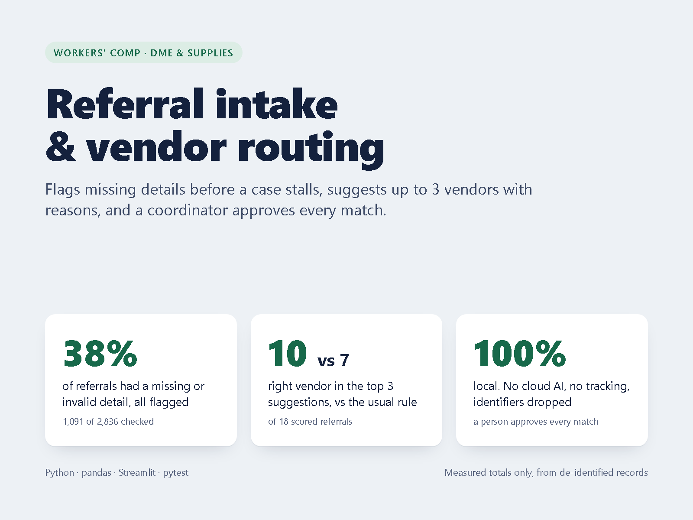
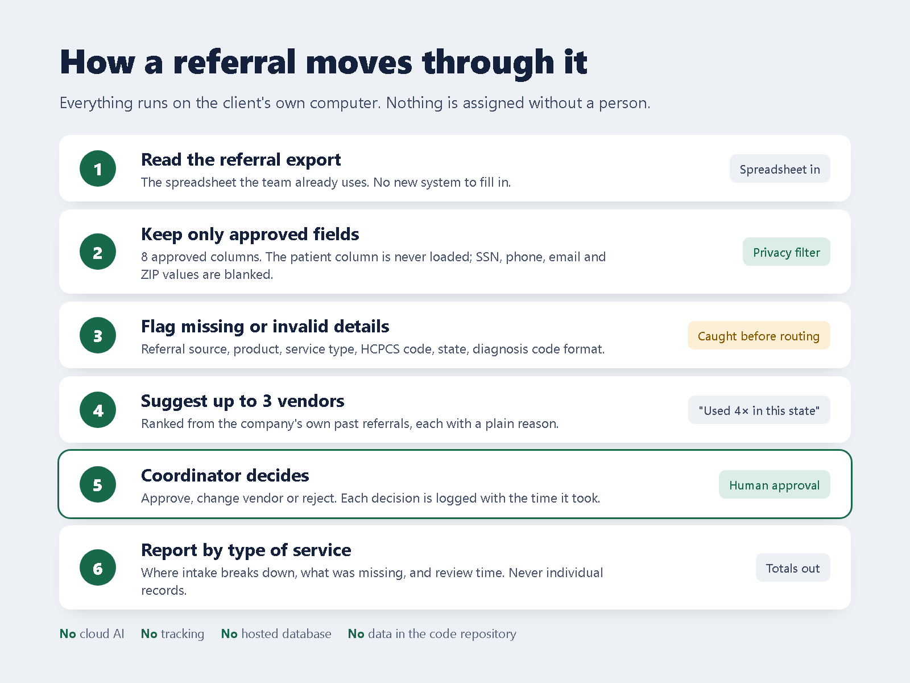

<!-- Cover image goes here once added:  -->

# H1 Referral Routing

**AI-assisted referral intake and vendor routing for workers' comp, with a coordinator approving every match.**

## The problem
Durable medical equipment and supply referrals pile up. Required details go missing and stall cases, and coordinators pick vendors from memory or spreadsheets. Each delay pushes back care for the injured worker.

## How it works
<!-- Workflow diagram goes here once added:  -->
1. Reads one de-identified referral from a spreadsheet export.
2. Extracts and cleans only the allowed fields.
3. Flags missing or invalid required information before routing.
4. Suggests up to 3 vendors, ranked, each with a plain-language reason (product, HCPCS code, diagnosis codes, carrier city, referral source).
5. Shows a coordinator screen: **Approve**, **Change vendor** or **Reject**. Nothing is assigned without a person, and every decision is logged with the time it took.
6. Produces four summary totals for reporting, never individual records.

## Safeguards
- **Local only.** Runs entirely on the client's own computer. No cloud AI, no tracking, no hosted database.
- **Allowlisted, de-identified fields.** The importer keeps 11 approved columns and drops everything else, including any patient, adjuster, claim or contact columns. Values that look like an SSN, phone number, email or ZIP code are blanked.
- **Human approval** on every referral, with a decision log.
- **Honest measurement.** Suggestions are learned from earlier years and scored only on a later year, always next to a simple "most common vendor for this product" baseline.

## Results
Tested on de-identified referrals from my own company's records. Totals only; nothing here is estimated.
- **Intake quality:** 1,091 of 2,836 referrals (38%) had a missing or invalid detail, all flagged before routing. Problems cluster by type of service: nursing 73%, respiratory 45%, DME 44%, down to hearing aids at 8%. The most common gap was no referral source (770 referrals).
- **Vendor shortlist:** the vendor actually used was in the 3 suggestions for 10 of 18 scored referrals, compared with 7 of 18 for the simple rule "use the most common vendor for this product".
- **Review time per referral:** 2.75 minutes by hand today; time with the tool is being measured.

## What a client gets
- Setup on the client's own export and routing rules
- The coordinator approval screen
- A measurement report built from these four totals

## Built With
Python, pandas, Streamlit, pytest.

---
Built by Daniel Schley
