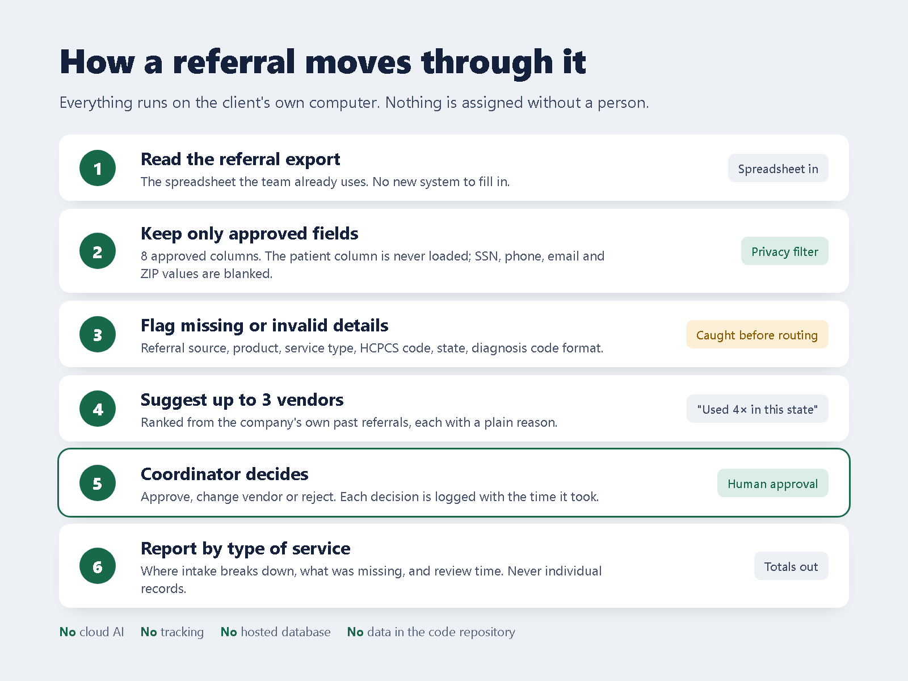

# Case study: Workers' Comp Referral Intake & Vendor Routing

**Headline:** 38% of referrals arrived with a missing or invalid detail, and nursing referrals were the worst at 73%
**Status:** MVP tested on 2,836 de-identified referrals (2025–2026) from my own company's records

## The problem
Equipment and supply referrals arrive with gaps. Coordinators chase missing details after the case has already stalled, and pick vendors from memory or old spreadsheets. Each delay pushes back the injured worker's equipment.

## What I built
- **Intake:** reads the referral export and keeps only 8 approved columns. The patient column is never loaded.
- **Missing-information rules:** every referral is checked for a referral source, product, service type, valid HCPCS code, state and a correctly formatted diagnosis code before it can be routed.
- **Grouping by type of service:** problems are counted by service type, so the team sees *where* intake breaks down, with a by-field count showing *what* is missing.
- **Vendor shortlist:** up to 3 vendors for each new referral, ranked from the company's own past referrals, each with a plain-language reason such as "Used for this product in this state 4 times".
- **Coordinator approval screen:** Approve, Change vendor or Reject. Nothing is assigned without a person, and every decision is logged with the time it took.

## Rules and safeguards
- **Local only:** runs on the client's own computer, with no cloud AI, no tracking and no hosted database. A test fails the build if any code tries to reach the internet.
- **Identifiers never kept:** patient, adjuster, claim, SSN, ZIP and contact columns are dropped at import. Any value that looks like an SSN, phone number, email or ZIP code is blanked, and vendor and source names are replaced with labels.
- **A person decides:** the system suggests; the coordinator approves, changes or rejects.
- **Data can't leak into the code repository:** data files are blocked from every commit automatically.

## Results
*Measured on de-identified referrals from my own company's records. Totals only; no individual referral is shown.*

**Intake quality: 2,836 referrals checked.** 1,091 (38%) had at least one missing or invalid detail, and all 1,091 were flagged before routing.

| Type of service | Referrals with a problem |
|---|---|
| Nursing | 48 of 66 (73%) |
| Transportation | 11 of 23 (48%) |
| Respiratory | 61 of 136 (45%) |
| DME | 175 of 402 (44%) |
| IV Therapy | 54 of 126 (43%) |
| Orthotics | 306 of 896 (34%) |
| Medical Supplies | 147 of 488 (30%) |
| Prosthetics | 82 of 368 (22%) |
| Hearing Aids | 4 of 48 (8%) |

*Selected service types with 20+ referrals. Another 111 referrals had no service type recorded at all.*

**What was missing:** no referral source on 770 referrals, no product on 126, no service type on 111, a blank or invalid HCPCS code on 108, no state on 46. The biggest gap, an unknown referral source, means nobody knows who to call back when a case stalls.

**What it means for operations:** problems cluster by type of service. Fixing how nursing, respiratory and DME referrals are taken in would remove a large share of the rework. That's a process fix to make before automating anything.

**Vendor shortlist:** learned only from 2025 referrals, then tested on the 970 referrals from 2026 that had a recorded vendor. The top suggestion matched the vendor actually used for **940 of 970 (97%)**, compared with 754 of 970 (78%) for the simple rule "use the most common vendor for this product".

| 2026 referrals | Tool, top pick | Simple rule |
|---|---|---|
| Product seen in 2025 (769) | 754 | 754 |
| New product or no product listed (201) | 186 | 0 (no history to use) |

The whole gain comes from new products: when a product had no history, the tool fell back on the HCPCS code and service type. Where a product had more than one past vendor (20 referrals), the top pick tied the simple rule at 9 of 20, and the right vendor was in the top 3 for 19 of 20, which is why a coordinator still makes the final choice.

**Review time per referral:** 2.75 minutes by hand today. *Time with the tool is being measured; added once timed, never estimated.*

## Relevant experience
[Daniel's own words on real referral-intake work, client unnamed]

## Who it's for
Workers' comp managed care networks, TPAs, case management and DME intake teams.
